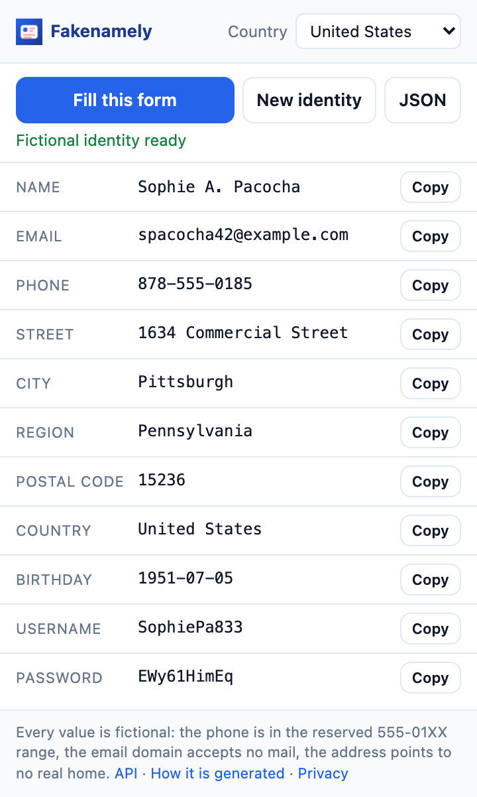

# Fakenamely – Fictional Identity Form Filler (Chrome extension)

Fill sign-up, checkout and account forms with a **fictional** identity in one click: a name, a street address whose city, state and postal code agree (real postal codes, 38 countries), a phone number from the reserved 555-01XX range, an example.com email that can never receive mail, a birthday, a username and a password.

Built for QA engineers, developers and designers who fill the same test form fifty times a day, and for anyone who would rather not hand a real address to a site that only needs a plausible one.

## How it works

1. Click the toolbar icon. A fictional identity for the selected country appears, fetched from the free [Fakenamely API](https://fakenamely.com/api).
2. Press **Fill this form**. The extension writes the values into the form on the current tab, matching fields by their `autocomplete` attribute first, then by name, id, placeholder and label text. Select boxes for state/region and country are matched by option text or code. React, Vue and Angular forms see the input because values are set through the native setter and `input`/`change` events are fired.
3. Press **New identity** for another, or copy a single field or the whole record as JSON.

Nothing runs in the background. The page is touched only on the tab where you press the button, through Chrome's `activeTab` permission.

## Why the data is safe to type into a real form

- **Phone**: 555-0100 to 555-0199, the block the North American Numbering Plan reserves for fiction; it cannot ring anyone.
- **Email**: example.com, example.net or example.org (RFC 2606), which publish a null MX record (RFC 7505) — a conforming mail server does not even attempt delivery.
- **Address**: a real city, state and postal code that agree with each other, with an invented street and house number; it points to no home.
- **Everything else** (names, birthday, username, password) is generated; the SSN-style field is masked and never a real number.

Use it for testing, demos and privacy on forms that do not need your real details. Never for fraud, impersonation, shipping, billing, KYC, banking, government or anything that requires a real identity.

## Install from source (developer mode)

1. Clone this repository or download it as a ZIP and unpack it.
2. Open `chrome://extensions`, enable **Developer mode**, click **Load unpacked** and pick the folder.
3. Pin the icon. Works in Chrome, Edge, Brave and other Chromium browsers.

A Chrome Web Store listing is in preparation; the packaged ZIP is built with `scripts/package.sh`.

## Privacy

No analytics, no tracking, no accounts. The only network request is the identity request to fakenamely.com. The last identity and your country choice are kept in `chrome.storage.local` on your device. Full text: [PRIVACY.md](PRIVACY.md).

## Related

- [Fakenamely](https://fakenamely.com) — the generator itself, with per-country, per-state and per-city pages.
- [`fakenamely` on npm](https://github.com/vinceblock99/fakenamely-js) — the official API client and CLI.
- [Email addresses that break software](https://fakenamely.com/blog/email-addresses-that-break-software) — why the emails here are at RFC 2606 domains, and how 8 validators treat 32 edge cases.

MIT licensed.
